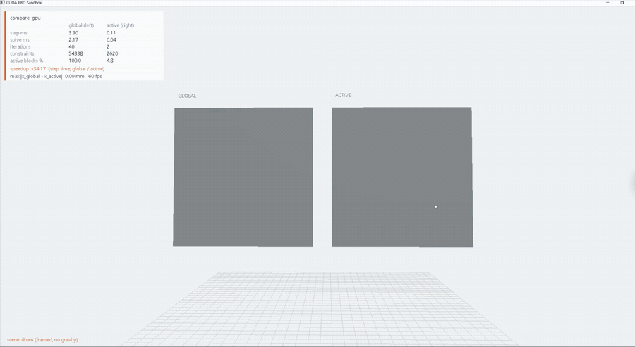
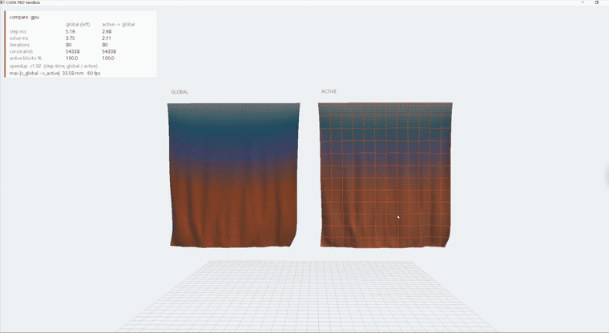

# CUDA-PBD-Sandbox

<p align="center"></p>
<p align="center"><sub>실시간 뷰어 비교 모드 (RTX 3090). 왼쪽 global, 오른쪽 active 솔버에 같은 입력을 주고, 주황 칸은 이번 프레임에 보정한 블록입니다.</sub></p>

**C/C++ · CUDA · OpenGL · CMake** — 석사 연구 [VDR](https://github.com/soz1p/VDR-Showcase)의 활성 블록 제한 보정을 공개용으로 다시 구현한 데모입니다. 연구실 코드와 CT 데이터 대신 합성 격자 천(cloth)으로 처음부터 새로 작성한 GPU Position-Based Dynamics 실험 프로젝트입니다. 같은 장면을 CPU·GPU의 전체(global) 보정과 **활성 블록 제한(active) 보정**으로 풀어 비용과 결과를 비교하고, 실시간 뷰어로 두 솔버를 나란히 확인할 수 있습니다.

| 96×96 천, RTX 3090 | step | 평균 활성 블록 |
| --- | ---: | ---: |
| GPU global | 1.223 ms | 100 % |
| GPU active | **0.565 ms (×2.16)** | 28.7 % |

## Build

필요한 것: CMake 3.18 이상, C++17 컴파일러, (GPU 솔버) CUDA Toolkit 11.x 이상. 뷰어는 Windows 전용이며 외부 라이브러리 없이 Win32와 OpenGL 3.3만 사용합니다.

**Windows · Visual Studio 2019**

```bat
cmake -S . -B build -G "Visual Studio 16 2019" -A x64
cmake --build build --config Release
build\Release\pbd_viewer.exe          :: 실시간 뷰어
build\Release\pbd_bench.exe           :: 벤치마크
```

`build/CudaPbdSandbox.sln`을 Visual Studio로 열어 빌드·디버깅할 수도 있습니다 (시작 프로젝트: `pbd_viewer`). Visual Studio 2022는 `-G "Visual Studio 17 2022"`를 사용합니다.

**Linux (CPU 또는 CUDA, 뷰어 제외)**

```bash
cmake -S . -B build -DCMAKE_BUILD_TYPE=Release
cmake --build build -j
./build/pbd_bench --solvers cpu,gpu,active
```

| CMake 옵션 | 기본값 | 의미 |
| --- | --- | --- |
| `PBD_ENABLE_CUDA` | `ON` | CUDA 컴파일러가 있으면 GPU 솔버를 빌드합니다. `OFF`면 CPU 솔버만 빌드합니다. |
| `CMAKE_CUDA_ARCHITECTURES` | `75 86 89` | RTX 20 / 30 / 40 시리즈. 다른 GPU는 `-DCMAKE_CUDA_ARCHITECTURES=<sm>` |

## 실시간 뷰어 (pbd_viewer)

빌드 후 `pbd_viewer.exe`를 실행합니다. Win32와 OpenGL 3.3만 사용하므로 GLFW·GLEW 같은 외부 라이브러리를 설치할 필요가 없습니다. CUDA 장치가 있으면 `gpu-active`로 시작합니다.

| 입력 | 동작 |
| --- | --- |
| 왼쪽 드래그 | 천의 한 점을 잡아 당기기 (카메라를 마주보는 평면 위에서 이동) |
| 오른쪽 드래그 · 휠 | 카메라 회전 · 확대/축소 |
| `1` `2` `3` `4` | `cpu` · `cpu-active` · `gpu` · `gpu-active` 솔버 전환 (현재 상태를 이어받음) |
| `C` | **비교 모드**: global(왼쪽)과 active(오른쪽)를 같은 입력으로 나란히 실행 |
| `P` | 장면 전환: 틀에 고정된 천(중력 0) ↔ 위쪽이 고정된 커튼(중력) |
| `N` | 해상도 전환 48 → 64 → 96 → 128 → 160 |
| `W` · `B` | 와이어프레임 · 활성 블록 표시 |
| `Space` · `R` · `Esc` | 일시정지 · 초기화 · 종료 |

- 천의 색은 처음 위치에서 움직인 거리입니다 (회색 → 청록 → 보라 → 주황).
- 활성 블록 솔버에서는 이번 프레임에 보정한 블록이 주황 테두리로 표시되고, 그 안의 천은 살짝 붉게 칠해집니다.
- 왼쪽 위 패널에 솔버, 프레임당 계산 시간, 반복 횟수, 활성 블록 비율, 보정한 제약 수, FPS가 표시됩니다.
- CUDA 장치가 없으면 `3` `4`를 눌러도 CPU 솔버가 유지되고 화면 아래에 안내가 나옵니다.

### Global과 Active 비교하기

- **뷰어:** `C`를 누르면 같은 천 두 장이 나란히 놓입니다. 왼쪽은 global, 오른쪽은 active 솔버이고, 어느 쪽을 잡아당겨도 **같은 정점에 같은 입력**이 두 솔버에 동시에 들어갑니다. 비교 중 `1`·`2`는 CPU 쌍, `3`·`4`는 GPU 쌍으로 바꿉니다.
- 패널에는 두 솔버의 step·solve 시간, 반복 수, 보정한 제약 수, 활성 블록 비율(약 1초 이동 평균)과 **속도 향상(global ÷ active)**, 두 천의 **최대 위치 차이(mm)**가 표시됩니다. 위치 차이는 잠든 블록을 고정점으로 다루면서 생기는 근사 오차입니다.
- **수치 기록:** 정확한 값은 벤치마크로 남깁니다. `pbd_bench --solvers gpu,active --n 128 --csv bench.csv` 을 실행하면 프레임별 시간과 활성 블록 수가 CSV로 저장됩니다.

## Solvers

| 솔버 | 설명 |
| --- | --- |
| `cpu` | 기준 구현. GPU와 같은 Jacobi 방식으로 모든 제약을 보정 |
| `gpu` (gpu-global) | 제약 하나당 스레드 하나. `atomicAdd`로 정점별 보정량을 누적하고, 정점 커널에서 평균을 적용 |
| `active` (gpu-active) | 움직이는 블록과 그 이웃 블록만 보정. 나머지 블록은 잠들어 고정점처럼 동작 |
| `cpu-active` | `active`와 같은 스케줄링을 CPU에서 재현한 참조 구현 (테스트·비교용) |

## How it works

```
frame
 ├─ schedule (active only)
 │    mark    : |v| > sleepSpeed 이거나 잡힌 정점이 있는 블록 → restless
 │    calm    : 제약 오차가 sleepError보다 크고 아직 변하는 블록 → restless
 │              sleepFrames 연속으로 restless가 아닌 블록만 잠듦, 나머지는 seed
 │    dilate  : seed 블록 + 8-이웃 블록 → active, 활성 블록 목록 작성
 │    fallback: active 비율 > globalFallback(70%) 이면 이번 프레임은 global 경로로 계산
 │    gather  : 활성 블록의 CSR 구간에서 제약을 모아 하나의 목록으로 압축
 │              (두 블록에 걸친 제약은 atomicExch 스탬프로 한 번만 등록)
 └─ substeps × (predict → Jacobi iterations → velocity update)
      project : 제약당 1 스레드, 보정량을 atomicAdd로 누적
      apply   : 정점당 1 스레드, p += ω · Δ / count, 누적 버퍼 초기화
      error   : max |C| / rest 를 atomicMax로 계산, 허용 오차 이하이면 조기 종료
```

- **Constraint:** 거리 제약 `C = |pⱼ − pᵢ| − rest`. 구조·전단·굽힘 세 종류를 격자에서 생성합니다. 굽힘도 별도의 이면각 제약이 아니라 한 칸 건너뛴 정점 사이의 거리 제약으로 근사한 것이라, 모든 제약이 같은 거리 제약 하나로 계산됩니다.
- **Jacobi + over-relaxation:** Gauss-Seidel은 순서 의존적이라 병렬화가 어렵습니다. 모든 제약을 동시에 투영하고 정점마다 평균을 내며, `relaxation`(기본 1.5)으로 수렴을 앞당깁니다.
- **Substeps:** 한 프레임을 8개의 작은 단계로 나눠 각 단계에서 최대 10회 반복합니다. 같은 총 반복 수에서 큰 단계 한 번보다 오차가 훨씬 작습니다.
- **Block table:** 격자를 8×8 정점 블록으로 나누고, 제약을 *양 끝점이 속한 모든 블록*에 등록한 CSR 표(`BlockConstraintTable`)를 만듭니다. 경계에 걸친 제약이 빠지지 않습니다.
- **Sleeping:** 활성 블록 밖의 정점은 적분하지 않고, 경계 제약에서는 역질량 0의 고정점으로 취급합니다.
- **언제 잠드는가:** 속도만 보고 바로 재우면 아직 펴지는 중인 천이 울퉁불퉁한 채로 굳습니다. 그래서 블록은 ① 모든 정점이 `sleepSpeed`(0.002 m/s)보다 느리고 ② 제약 오차가 `sleepError`(0.2%) 이하이거나 더 이상 변하지 않는 상태(평형, 예: 중력 아래 처진 천)가 ③ `sleepFrames`(30) 프레임 연속으로 유지될 때만 잠듭니다. 오차는 블록마다 매 프레임 갱신합니다.
- **Global fallback:** 깨어 있는 블록이 많아지면 목록을 모으고 경계를 판정하는 비용이 계산 절감분보다 커집니다. 활성 비율이 `globalFallback`(70%)을 넘는 프레임은 스케줄링을 건너뛰고 global 경로로 계산합니다. 큰 변형에서는 활성 블록 기법의 이득이 줄어든다는 석사 연구의 결론(Large 조건 2.54×)과 같은 이유입니다.

### 잠드는 규칙과 fallback의 효과

64×64 천을 한 점에서 0.5초 당겼다 놓고 7초 동안 둔 뒤 global 결과와 비교했습니다 (CPU 참조 구현, fallback 기준 60%로 측정).

| 장면 | 규칙 | global과 최대 위치 차이 | 평균 활성 블록 | step (active / global) |
| --- | --- | ---: | ---: | ---: |
| 틀 고정, 중력 0 | 속도만 보고 즉시 수면 (이전) | 21.0 mm | 17.4 % | 3.96 / 9.13 ms |
| 틀 고정, 중력 0 | 30프레임 연속 + 오차 기준 + fallback | **2.1 mm** | 73.6 % | 8.12 / 9.07 ms |
| 커튼, 중력 9.81 | 30프레임 연속 + 오차 기준, fallback 없음 | 0.04 mm | 100 % | 29.50 / 15.77 ms |
| 커튼, 중력 9.81 | 30프레임 연속 + 오차 기준 + fallback | **0.00 mm** | 100 % | **15.55 / 15.14 ms** |

- 이전 규칙은 빠르지만 천이 덜 펴진 채로 잠들어 global과 21 mm 차이가 났습니다. 새 규칙은 2 mm 수준으로 global과 거의 같은 모양으로 가라앉습니다.
- 중력 아래 커튼은 계속 흔들려 거의 모든 블록이 깨어 있습니다. fallback이 없으면 스케줄링 비용 때문에 global보다 2배 가까이 느려지고, fallback이 있으면 global과 같은 비용으로 같은 결과를 냅니다.

<p align="center"></p>
<p align="center"><sub>중력 아래 커튼. 거의 모든 블록이 깨어 있어 오른쪽 active 솔버가 global 경로로 넘어갑니다 (패널의 "active -> global").</sub></p>

## Benchmark

```bash
pbd_bench --solvers gpu,active --n 96 --csv bench.csv
```

장면: 네 변이 고정된 천(중력 0, 드럼 가죽처럼 틀이 천을 지지)을 360프레임마다 다른 위치에서 30프레임 동안 눌렀다 놓습니다. 누르는 동안에는 파동이 퍼지고, 놓으면 감쇠하며 가라앉습니다.

| 96×96 (9,216 정점, 54,338 제약) | step (ms) | 평균 활성 블록 | global fallback 프레임 | 보정한 제약 |
| --- | ---: | ---: | ---: | ---: |
| `cpu` | 23.64 | 100 % | — | 54,338 |
| `cpu-active` | 14.03 | 31.3 % | 26 % | 17,087 |
| `gpu` | **1.223** | 100 % | — | 54,338 |
| `active` | **0.565** (×2.16) | 28.7 % | 15 % | 15,754 |

<sub>720프레임 동안 360프레임마다 30프레임씩 누른 결과입니다. GPU는 RTX 3090, VS2019 Release x64, fallback 기준 70%에서 측정했고 최종 최대 상대 제약 오차는 global 0.027%, active 0.045%입니다. CPU는 클라우드 x86 단일 스레드에서 fallback 기준 60%로 잰 참고값입니다. 누르는 간격이 짧아 천이 가라앉을 시간이 없으면(예: `--cycle 120`) 대부분의 블록이 깨어 있어 active의 이득이 사라지고 fallback이 global 경로를 사용합니다.</sub>


### Options

| 옵션 | 기본값 | 의미 |
| --- | --- | --- |
| `--n` | 96 | 격자 해상도 (n × n 정점) |
| `--substeps` / `--iters` / `--tol` | 8 / 10 / 1e-2 | 서브스텝 수, 서브스텝당 최대 반복, 조기 종료 오차 |
| `--block` / `--sleep` | 8 / 0.002 | 블록 크기, 잠드는 속도(m/s) |
| `--sleep-frames` / `--sleep-error` | 30 / 2e-3 | 잠들기 전 연속 정지 프레임 수, "평평함"으로 보는 상대 제약 오차 |
| `--fallback` | 0.7 | 활성 비율이 이 값을 넘으면 global 경로 사용 (1 = 사용 안 함) |
| `--pin` | frame | `frame` · `top` · `corners` |
| `--gravity` | 0 | 중력 크기 (m/s²) |
| `--cycle` / `--poke` / `--amp` | 360 / 30 / 0.05 | 누르는 주기, 누르는 프레임 수, 깊이(m) |
| `--solvers` | gpu,active | `cpu` · `cpu-active` · `gpu` · `active` 중 쉼표로 구분 |
| `--csv FILE` | — | 프레임별 결과를 CSV로 저장 |
| `--dump DIR --dump-every K` | — | K 프레임마다 정점 위치를 텍스트로 저장 |

## Project layout

```
include/pbd/   math.h (host/device 공용 수학, 거리 제약 투영) · cloth.h · blocks.h · solver.h · timer.h
src/           cloth.cpp · blocks.cpp · cpu_solver.cpp · cpu_active_solver.cpp · gpu_solver.cu
apps/          bench.cpp (벤치마크)
apps/viewer/   main.cpp (Win32 창·입력·비교 모드) · gl_api (OpenGL 로더) · camera.h · cloth_renderer (셰이더·메시)
docs/          README용 GIF와 화면 기록
```

## Limitations

- Jacobi는 Gauss-Seidel보다 수렴이 느리고, 중력 아래 긴 천은 늘어나는 오차가 남습니다(서브스텝으로 완화).
- 잠든 영역의 경계를 고정점으로 다루므로, 활성 영역이 너무 작으면 경계에서 변형이 끊겨 보일 수 있습니다. 8-이웃 halo와 30프레임 연속 정지 조건으로 완화합니다.
- 중력 아래에서는 Jacobi 잔여 오차 때문에 천이 아주 느리게 계속 움직여 블록이 잘 잠들지 않습니다. 이때는 fallback이 global 경로로 돌려 손해를 막을 뿐, 이득은 없습니다.
- `atomicAdd` 누적은 합산 순서가 실행마다 달라 결과가 비트 단위로 결정적이지 않습니다 (CPU와의 차이는 1 mm 이내).
- 충돌 처리와 XPBD(compliance)는 범위 밖입니다.

## License

MIT
